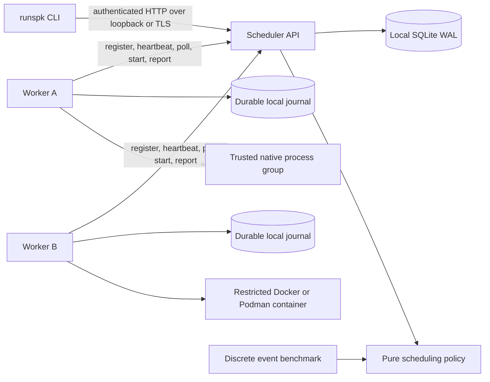

# Architecture

The Cargo workspace contains one implementation crate with four binaries: `runspk-scheduler`, `runspk-worker`, `runspk`, and the offline `runspk-bench`. Shared modules hold wire types, policies, the SQLite store, the HTTP client/server, execution backends and worker journals. This keeps protocol and policy behavior consistent without splitting the project into services that need separate releases.

The scheduler serializes mutations with a mutex, and moves SQLite work to Tokio's blocking pool. SQLite uses WAL and FULL synchronous commits. An exclusive lock prevents two schedulers from sharing a database. Jobs, attempt metadata, stdout/stderr prefixes, worker registrations and submission keys are durable. Global placements and each completion/retry transition commit in transactions. Reservations are derived from active job rows; there is no independent counter to forget to decrement.

Workers pull every 100 ms, renew individual execution leases through reports every 200 ms, and send worker heartbeats every second. Completion replay and directory scans run once per second; replay rotates through pending attempts with a time/request budget in one background transfer task, so a slow upload cannot block heartbeats. The scheduler checks leases every 500 ms. Assigned work needs a start acknowledgement before execution. Workers use persistent sessions and fsynced journals to resolve crashes. They execute only the allocated command and resource envelope; remote workers need no inbound port. `--local` embeds the same worker protocol rather than a separate execution path.

Journal reads, writes, removals and fsync run through one semaphore-bounded blocking operation per worker journal. The blocking closure owns both its permit and the journal lock lifetime, so cancellation cannot allow overlapping disk mutations. Launch still awaits both durable writes and checks its monotonic start deadline before opening stdin. Process-group verification runs on the blocking pool too. A stalled disk can delay launch or completion, while other execution watchdogs remain runnable; it never authorizes releasing an uncertain reservation. Startup-only journal opening is synchronous. No Store mutex guard crosses an await.

`worker.rs` owns registration, local restart fencing, polling, CPU-slot ownership and completion replay. `runner.rs` owns one gated execution and its watchdog; `backend.rs` owns command construction and container cleanup. `policy.rs` stays pure. `store.rs` owns transactional job/attempt transitions; its `schema`, `history`, `backup` and `transfers` submodules hold schema initialization, inspection/pruning, standalone online backup and immutable input/output persistence. `workspace.rs` validates and transfers bounded files; `staging.rs` prepares attempt workspaces and collects stopped outputs. `profile.rs` owns private local connection files. CLI setup, submission and presentation live in cohesive helper modules. Transport and authentication stay in `api.rs`/`client.rs`.

Indexed generated columns project lease deadlines, worker IDs and finish times from durable job JSON. There is no second mutable representation to synchronize. Expiry reads only expired active leases; reservation accounting excludes queued/history records; stats use SQL aggregation. A saturated global worker inventory skips policy planning, and an existing assignment is fetched directly. Other passes still read and sort the live queue. No scheduling cache or invalidation protocol is introduced. Transactional input snapshots and per-attempt artifacts live in separate tables, with an indexed generated workspace reference on jobs.

The API is deliberately small: `/jobs` with optional filters/cursors, per-job status/cancel/logs/attempts/resolve/explain, `/history/prune`, `/workers`, `/stats`, and authenticated `/worker/*` control operations. Every route is administrative. Errors return an HTTP status and a JSON error where handled by the application; Clap handles command syntax. The CLI prints IDs on submission, terminal tables for inspection and text for logs. Piped inspection output remains JSON; `--json` and `--human` make the choice explicit. `--json logs --follow` emits JSON snapshots, one per line; `run --json` emits submitted/logs/finished events. Logs retain separate stream order; a total ordering between stdout and stderr is not reconstructed. Text conversion replaces invalid UTF-8.

Jobs fit one worker. Native inputs can use existing worker-side paths or bounded immutable [project snapshots](WORKSPACES.md). Outputs are explicitly declared and captured only after confirmed termination. Native jobs can also write ordinary account-accessible files. Container inputs belong in preloaded images, and outputs are captured logs. GPU ownership is by exclusive UUID, with optional capacity and affinity filters. Measured GPU discovery values and benchmark usage are separate from reservations.

The [state machines](FAILURE-MODEL.md), [policy assumptions](SCHEDULING.md), and [security boundary](SECURITY.md) define the operational contract. Single control-plane availability, finite worker polling, native process cooperation, and reliable local storage are explicit assumptions. This release has no HA, cross-host collective jobs, job DAGs, tenant separation or automatic historical-record pruning.
